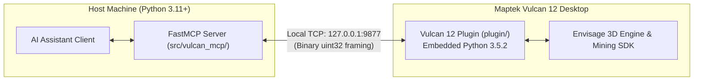

# Contributing to Vulcan MCP

Thank you for your interest in contributing to **Vulcan MCP**! This project connects Maptek Vulcan 12 Desktop with Artificial Intelligence assistants via the open Model Context Protocol (MCP).

To maintain high architectural integrity, stability, and compatibility across both environments, please review these contributing guidelines before submitting code.

---

## 1. Two-Process Architecture Overview

Vulcan MCP operates across two distinct Python environments:



* **External MCP Server (`src/vulcan_mcp/`)**: Runs in **Python 3.11+** using `FastMCP` and Pydantic v2. Modern Python idioms, type annotations, and async patterns are encouraged here.
* **Internal Plugin (`plugin/`)**: Executes inside Maptek Vulcan 12's embedded **Python 3.5.2** interpreter on Vulcan's main thread to preserve the Envisage OpenGL graphics context.

---

## 2. Development Setup

We use [`uv`](https://docs.astral.sh/uv/) for deterministic dependency and environment management.

### Prerequisites
* Python 3.11 or higher
* `uv` installed (`pip install uv` or `winget install astral-sh.uv`)
* Git & GitHub CLI (`gh`)

### Setup Environment
```powershell
# Clone the repository
git clone https://github.com/LuiccianDev/vulcan-mcp.git
cd vulcan-mcp

# Synchronize dependencies
uv sync
```

---

## 3. Core Development Guardrails

> [!CAUTION]
> ### Strict Python 3.5.2 Compatibility in `plugin/`
> The code inside `plugin/` (including all files in `plugin/handlers/`) runs directly in Vulcan 12's embedded Python 3.5.2 interpreter.
> - **Strictly Prohibited**: Do **NOT** use f-strings (`f"..."`) inside `plugin/`. Use `.format()` or `%` formatting.
> - **Strictly Prohibited**: Do **NOT** use function type hints or variable annotations inside `plugin/`.
> - AST tests (`tests/test_vulcan_mcp.py`) will automatically fail your pull request if an f-string is detected in `plugin/`.

### Zero `.env` Philosophy
Do **not** create `.env` files in this repository. Authentication tokens are managed securely at the Windows OS environment level:
```powershell
[System.Environment]::SetEnvironmentVariable('VULCAN_MCP_TOKEN', $token, 'User')
```

### 3D Viewport Performance Safeguards
When rendering temporary CAD objects or drillholes via `maptek.vulcan_gui`, always restrict the number of rendered items to a safe limit ($\le 300$ segments) to avoid freezing Envisage's OpenGL rendering loop.

---

## 4. Feature Branch Workflow

To keep the `master` branch stable and releasable:

1. **Always create a dedicated feature branch**:
   ```powershell
   git checkout master
   git pull origin master
   git checkout -b feat/<short-description>
   ```

2. **Branch Naming Standard**:
   - `feat/<feature-name>`: New tools, handlers, or capabilities.
   - `fix/<bug-name>`: Bug fixes or error handling.
   - `refactor/<module>`: Internal refactoring without API changes.
   - `docs/<topic>`: Technical documentation or guide updates.
   - `test/<area>`: Test harness expansions.

---

## 5. Conventional Commits Standard

All commits must follow the [Conventional Commits](https://www.conventionalcommits.org/) specification:

$$\mathtt{type(scope): description}$$

### Allowed Types
* `feat`: A new feature or MCP tool action.
* `fix`: A bug fix.
* `docs`: Documentation updates.
* `refactor`: Code change that neither fixes a bug nor adds a feature.
* `test`: Adding or correcting tests.
* `chore`: Maintenance tasks, dependencies, or configuration.

### Examples
* `feat(drillholes): add bilingual support for Spanish assay tables`
* `fix(block_model): resolve coordinate offset in spatial queries`
* `docs(tutorials): expand 15-minute quickstart guide`

---

## 6. Testing & Quality Verification

Before submitting changes, all checks must pass:

```powershell
# 1. Run offline unit and AST tests (validates Python 3.5 compatibility)
uv run --no-sync pytest tests/test_vulcan_mcp.py -v

# 2. Run mock harness & agent evaluation suite
uv run --no-sync pytest tests/test_mcp_tools.py tests/test_agent_eval.py -v

# 3. Linting and formatting
uv run --no-sync ruff check .
uv run --no-sync ruff format --check .

# 4. Static type checking (MCP server)
uv run --no-sync mypy src/
```

---

## 7. Submitting a Pull Request

Once your branch is tested and committed:

1. **Push your branch to GitHub**:
   ```powershell
   git push -u origin feat/<feature-name>
   ```

2. **Open a Pull Request**:
   Using GitHub CLI (`gh`):
   ```powershell
   gh pr create --title "feat: <description>" --body "Closes #<issue>. Validated with pytest."
   ```
   Or via the GitHub web interface at [https://github.com/LuiccianDev/vulcan-mcp/pulls](https://github.com/LuiccianDev/vulcan-mcp/pulls).

3. **Changelog**: If your PR introduces significant features or fixes, include a bullet under `## [Unreleased]` in [`CHANGELOG.md`](./CHANGELOG.md).

Thank you for helping make Vulcan MCP better!
