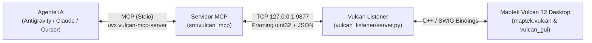

# Vulcan MCP — Connect Maptek Vulcan 12 Desktop to AI Agents via MCP

[](./LICENSE)
[](./pyproject.toml)
[](./docs/MAPTEK_PYTHON_SDK.md)
[](https://docs.astral.sh/uv/)

Conecta **Maptek Vulcan 12 Desktop (Envisage)** directamente con agentes de Inteligencia Artificial (**Google Antigravity**, **Claude Desktop**, **Claude Code**, **Cursor**, **VS Code**) a través del **Model Context Protocol (MCP)**.

Permite consultar modelos de bloques (`.bmf`), auditar triangulaciones 3D (`.00t`), explorar bases de datos de sondajes ISIS (`.dhd.isis`), operar diseños CAD (`.dgd.isis`), modificar leyendas (`.scd`), capturar la ventana 3D de Envisage y ejecutar scripts de PyVulcan en lenguaje natural.

---

## ✨ Características Principales (Features)

* **Modelos de Bloques (`.bmf`)**: Inspección de variables, esquemas de grillas, consulta puntual en $(X, Y, Z)$, cálculo de tonelaje, volumen y ley media ponderada con ley de corte (`cutoff`).
* **Triangulaciones y Sólidos 3D (`.00t` / `.tri`)**: Conteo de nodos y caras, cálculo de área superficial y volumen cerrado, validación topológica (`is_consistent`, `is_crossing`), centroide, interpolación de cota $Z$ y prueba de punto dentro de sólido (`point_inside`).
* **Bases de Datos de Sondajes (`.dhd.isis`)**: Soporte bilingüe automático (español/inglés: `COLLARES`, `DIRECCIONES`, `LEYES`, `BUZ`/`BUZAMIENTO`/`DIP`, `FROM`/`DESDE`), búsqueda de interceptos de alta ley y *desurvey* 3D coloreado por ley en el viewport de Envisage.
* **Diseño CAD 3D (`.dgd.isis`)**: Listado de bases de diseño y capas, estadísticas geométricas, cálculo de **área planar ($m^2$)** y centroide, carga en 3D y creación de polilíneas/polígonos cerrados.
* **Leyendas (`.scd`) y Captura Visual 3D**: Modificación de esquemas de color con respaldo automático `.scd.bak` y captura JPEG optimizada de la ventana 3D de Envisage (`vulcan_screenshot`).
* **Scripting PyVulcan (`vulcan_execute_code`)**: Ejecución directa de código Python dentro del intérprete de Maptek Vulcan con `vulcan`, `vulcan_gui` y `project_dir` pre-inyectados.

---

## 🏗 Arquitectura

**Vulcan MCP** se divide en dos componentes que se comunican por un socket TCP local (`127.0.0.1:9877`) con framing binario `uint32`:

* **AI Agent** $\leftrightarrow$ **MCP Server (`FastMCP` / `src/vulcan_mcp/server.py`)**: Corre fuera de Vulcan en `Python 3.11+` (ejecutado al vuelo vía `uvx` o `uv run`) y expone las **9 Herramientas Maestras**.
* **TCP Socket (`127.0.0.1:9877`)** $\leftrightarrow$ **Vulcan Listener (`vulcan_listener/server.py`)**: Corre dentro del intérprete embebido de Maptek Vulcan 12 (`Python 3.5.2`), procesando comandos en el hilo principal sobre el SDK nativo C++/SWIG (`maptek.vulcan` y `maptek.vulcan_gui`).



---

## 🚀 Inicio Rápido (Quick Start)

No necesitas crear ni configurar entornos virtuales manualmente si usas [`uv` / `uvx`](https://docs.astral.sh/uv/).

### Paso 1: Iniciar el Listener dentro de Maptek Vulcan 12

1. Descarga o clona este repositorio en tu equipo para tener la carpeta [`vulcan_listener/`](./vulcan_listener).
2. Abre tu proyecto minero en **Maptek Vulcan 12 Desktop (Envisage)**.
3. En el menú principal de Vulcan ve a **File > Python Script**.
4. Selecciona el archivo `vulcan_listener/server.py`, marca la casilla **"Run in shell window"** y haz clic en **OK**.
5. Se abrirá la ventana de consola mostrando:
   ```text
   [Vulcan MCP] Vulcan MCP Listener started on 127.0.0.1:9877
   ```

### Paso 2: Conectar tu Agente de IA (`uvx` directo desde GitHub)

#### En Claude Desktop / Cursor / VS Code / Windsurf (`mcp.json` / `claude_desktop_config.json`)
Ejecuta el servidor directamente desde GitHub con `uvx` sin necesidad de rutas locales:

```json
{
  "mcpServers": {
    "vulcan": {
      "command": "uvx",
      "args": [
        "--from",
        "https://github.com/LuiccianDev/vulcan-mcp/archive/refs/heads/master.zip",
        "vulcan-mcp-server"
      ]
    }
  }
}
```

#### En Claude Code (CLI)
```bash
claude mcp add -s user vulcan -- uvx --from https://github.com/LuiccianDev/vulcan-mcp/archive/refs/heads/master.zip vulcan-mcp-server
```

#### En Google Antigravity (Plugin Incluido o Local)
Este repositorio incluye el plugin completo en [`.agents/plugins/vulcan-mcp/`](./.agents/plugins/vulcan-mcp), que registra automáticamente el servidor MCP, el agente especialista **`mining-geologist`**, las **4 Skills** mineras y el hook de diagnóstico. Si prefieres ejecutar desde tu copia local con `uv`:

```json
{
  "mcpServers": {
    "vulcan": {
      "command": "uv",
      "args": [
        "run",
        "--directory",
        "C:\\ruta\\a\\vulcan-mcp",
        "vulcan-mcp-server"
      ]
    }
  }
}
```

---

## 🧰 Catálogo de las 9 Herramientas Maestras

Consulta todos los parámetros y respuestas JSON en [`docs/MCP_TOOLS_REFERENCE.md`](./docs/MCP_TOOLS_REFERENCE.md).

| # | Herramienta MCP | Dominio Minero | Acciones (`action=`) | Descripción |
| :-: | :--- | :--- | :--- | :--- |
| 1 | **`vulcan_system`** | Sistema y Proyecto | `ping`, `project_info`, `capabilities` | Estado de la conexión, inventario completo de archivos del proyecto y módulos SDK disponibles. |
| 2 | **`vulcan_block_model`** | Modelos de Bloques (`.bmf`) | `list`, `info`, `query_xyz`, `stats` | Esquema de bloques, consulta en $(X,Y,Z)$, tonelaje, volumen y ley media ponderada por corte (`cutoff`). |
| 3 | **`vulcan_triangulation`** | Triangulaciones (`.00t`/`.tri`) | `list`, `info`, `elevation`, `point_inside`, `load`, `unload` | Nodos, caras, volumen, consistencia topológica, centroide, cota $Z$ y punto dentro de sólido. |
| 4 | **`vulcan_design`** | Diseño CAD 3D (`.dgd.isis`) | `list_dbs`, `list_layers`, `layer_info`, `load_layer`, `clear_temp`, `create_polyline` | Inspección de capas CAD, longitud, área planar ($m^2$), centroide, carga en 3D y creación de polilíneas. |
| 5 | **`vulcan_drillholes`** | Sondajes ISIS (`.dhd.isis`) | `list_dbs`, `schema`, `holes`, `hole`, `high_grade`, `display`, `clear_display` | Tablas y columnas de sondajes, búsqueda de alta ley y *desurvey* 3D coloreado por ley en Envisage. |
| 6 | **`vulcan_legend`** | Leyendas (`.scd`) | `list`, `inspect`, `update`, `restore` | Inspección y actualización de esquemas de color con copia de seguridad `.scd.bak`. |
| 7 | **`vulcan_screenshot`** | Captura Visual 3D | *(Directa: `max_width`, `quality`)* | Captura de pantalla de la ventana 3D de Envisage comprimida en JPEG. |
| 8 | **`vulcan_canvas`** | Interfaz y Macros | `macro`, `report` | Ejecución de macros de Envisage Workbench y escritura en la ventana de reportes. |
| 9 | **`vulcan_execute_code`** | Scripting PyVulcan | *(Directa: `code`)* | Ejecución directa de Python dentro de Maptek Vulcan (`vulcan`, `vulcan_gui`, `project_dir`). |

---

## 🔒 Seguridad y Autenticación por Token (`VULCAN_MCP_TOKEN`)

Dado que el listener permite ejecutar código Python arbitrario en Vulcan (`vulcan_execute_code`), **Vulcan MCP** implementa el mismo modelo de seguridad de socket que [`nkarasiak/qgis-mcp`](https://github.com/nkarasiak/qgis-mcp):

1. **Comportamiento por defecto (`localhost`)**:
   * Por defecto, la autenticación por token está **desactivada**. El listener se enlaza exclusivamente a `127.0.0.1` (loopback), impidiendo conexiones desde otros equipos en la red y permitiendo que `uvx` funcione de inmediato.
2. **Activar Autenticación por Token (`VULCAN_MCP_TOKEN`)**:
   * Genera un secreto aleatorio largo:
     ```powershell
     python -c "import secrets; print(secrets.token_urlsafe(32))"
     ```
   * Define la variable de entorno `VULCAN_MCP_TOKEN` en el entorno donde se ejecuta Maptek Vulcan antes de iniciar `vulcan_listener/server.py` (la consola mostrará `Token authentication: ENABLED`).
   * Añade el mismo valor en el bloque `"env"` de tu cliente MCP (`uvx`):
     ```json
     {
       "mcpServers": {
         "vulcan": {
           "command": "uvx",
           "args": [
             "--from",
             "https://github.com/LuiccianDev/vulcan-mcp/archive/refs/heads/master.zip",
             "vulcan-mcp-server"
           ],
           "env": {
             "VULCAN_MCP_TOKEN": "tu-secreto-largo-aleatorio"
           }
         }
       }
     }
     ```
   * El listener verifica cada petición mediante comparación en tiempo constante (`hmac.compare_digest`).
3. **Regla Estricta Non-Loopback**:
   * Si configuras `VULCAN_MCP_HOST` en una dirección que **no sea loopback** (distinta de `127.0.0.1`, `localhost` o `::1`), **el listener se negará a arrancar a menos que `VULCAN_MCP_TOKEN` esté explícitamente definido**, evitando exponer ejecución remota de código sin contraseña en la red.

---

## 📚 Documentación Técnica (`docs/`) y Stack

| Componente | Tecnología | Versión | Documentación de Referencia |
| :--- | :--- | :--- | :--- |
| **Software Minero** | Maptek Vulcan Desktop (Envisage) | `12.x` | [`docs/VULCAN_FILE_FORMATS.md`](./docs/VULCAN_FILE_FORMATS.md) |
| **SDK Nativo Interno** | `maptek.vulcan` & `maptek.vulcan_gui` | `Python 3.5.2` (SWIG) | [`docs/MAPTEK_PYTHON_SDK.md`](./docs/MAPTEK_PYTHON_SDK.md) |
| **Servidor MCP** | `mcp[cli]` (`FastMCP`) + `pydantic` | `2.3.0` / `2.14.1` (`Python 3.12`) | [`docs/MCP_TOOLS_REFERENCE.md`](./docs/MCP_TOOLS_REFERENCE.md) |
| **Transporte y Seguridad** | Socket TCP `uint32` + HMAC | `127.0.0.1:9877` | [`docs/ARCHITECTURE_AND_SECURITY.md`](./docs/ARCHITECTURE_AND_SECURITY.md) |

---

## 🛠 Solución de Problemas y Pruebas

* **Un comando se detiene por Timeout (`CommandTimeout`)**: Verifica si Maptek Vulcan Desktop muestra una ventana modal emergente en pantalla (ej. *"No design database is currently open"*). En Vulcan, los diálogos modales pausan el hilo principal de Python hasta que pulsas **OK**.
* **Pruebas Unitarias (sin requerir Vulcan abierto)**:
  ```powershell
  uv run --no-sync pytest tests/test_vulcan_mcp.py -v
  ```
* **Pruebas de Integración en Vivo (con Maptek Vulcan 12 y el listener activos)**:
  ```powershell
  uv run --no-sync pytest tests/test_live.py -v
  ```

---

## ⚖️ Autoría, Licencia y Aviso Legal

* **Autor Original**: **DAVID (`LuiccianDev`)** — Copyright © 2026.
* **Licencia**: Distribuido bajo la licencia **[Apache License, Version 2.0 (Apache-2.0)](./LICENSE)**.
  * **Atribución obligatoria (`Sección 4.d`)**: Cualquier redistribución o derivado debe conservar íntegramente los avisos de autoría contenidos en [`NOTICE`](./NOTICE).
  * **Registro de cambios (`Sección 4.b`)**: Cualquier archivo modificado por terceros debe incluir un aviso claro indicando que fue alterado.
* **Aviso de Marcas Registradas**: *Maptek®, Vulcan®, Envisage® y Workbench® son marcas registradas de Maptek Pty Ltd. Este proyecto es un desarrollo independiente y no incluye ni redistribuye binarios ni código propietario de Maptek.*
