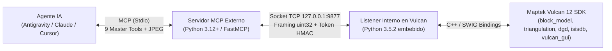

# Vulcan MCP — Integración de Maptek Vulcan 12 Desktop con IA

[](./LICENSE)
[](./pyproject.toml)
[](./docs/MAPTEK_PYTHON_SDK.md)
[](https://docs.astral.sh/uv/)

Puente de interoperabilidad basado en el **Model Context Protocol (MCP)** que conecta **Maptek Vulcan 12 Desktop (Envisage)** con asistentes de Inteligencia Artificial (**Google Antigravity**, **Claude Desktop**, **Cursor**, **VS Code**, **Claude Code**).

Diseñado con una arquitectura desacoplada en dos procesos para unir el intérprete embebido de Maptek Vulcan 12 (`Python 3.5.2` + bindings C++/SWIG `maptek.vulcan` y `maptek.vulcan_gui`) con el ecosistema moderno de IA (`Python 3.12+` / `FastMCP`), permitiendo consultar modelos de bloques, auditar triangulaciones, explorar sondajes ISIS, operar capas CAD 3D y capturar vistas de Envisage en lenguaje natural.

---

## Tabla de Contenidos

1. [Stack Tecnológico y Versiones](#-stack-tecnológico-y-versiones)
2. [Arquitectura de Comunicación](#-arquitectura-de-comunicación)
3. [Catálogo de las 9 Herramientas Maestras](#-catálogo-de-las-9-herramientas-maestras)
4. [Guía de Inicio Rápido](#-guía-de-inicio-rápido)
5. [Seguridad y Autenticación por Token (`.env` / `os.getenv`)](#-seguridad-y-autenticación-por-token-env--osgetenv)
6. [Ejemplos de Prompts Mineros](#-ejemplos-de-prompts-mineros)
7. [Documentación Técnica Detallada (`docs/`)](#-documentación-técnica-detallada-docs)
8. [Solución de Problemas (Troubleshooting)](#-solución-de-problemas-troubleshooting)
9. [Estructura del Proyecto](#-estructura-del-proyecto)
10. [Ejecución de Pruebas](#-ejecución-de-pruebas)
11. [Autoría, Licencia y Aviso Legal](#-autoría-licencia-y-aviso-legal)

---

## 🛠 Stack Tecnológico y Versiones

| Componente | Tecnología / Paquete | Versión | Rol en el Proyecto |
| :--- | :--- | :--- | :--- |
| **Software Minero** | Maptek Vulcan Desktop (Envisage) | `12.x` | Motor geológico, CAD 3D y modelamiento de bloques |
| **SDK Nativo Interno** | `maptek.vulcan` & `maptek.vulcan_gui` | `Python 3.5.2` (SWIG) | Lectura/escritura de `.bmf`, `.00t`, `.dgd.isis`, `.dhd.isis` y viewport 3D |
| **Runtime Servidor MCP** | CPython (gestionado por `uv`) | `3.12.9` (`>=3.11`) | Ejecución del servidor MCP externo asíncrono |
| **Framework MCP** | `mcp[cli]` (`FastMCP`) | `2.3.0` | Exposición de las 9 Herramientas Maestras y contenido visual |
| **Validación de Datos** | `pydantic` | `2.14.1` | Tipado y validación estricta de esquemas JSON |
| **Gestor de Paquetes** | `uv` (Astral) | Última estable | Resolución y ejecución sin gestión manual de entornos virtuales |
| **Suite de Pruebas** | `pytest` + `pytest-asyncio` | `9.1.1` / `1.4.0` | 9 pruebas unitarias + 9 niveles de pruebas de integración en vivo |

---

## 🏗 Arquitectura de Comunicación



---

## 🧰 Catálogo de las 9 Herramientas Maestras

Referencia completa de parámetros y respuestas JSON en [`docs/MCP_TOOLS_REFERENCE.md`](./docs/MCP_TOOLS_REFERENCE.md).

| # | Herramienta MCP | Dominio Minero | Acciones Incluidas (`action=`) | Capacidades Destacadas |
| :-: | :--- | :--- | :--- | :--- |
| 1 | **`vulcan_system`** | Sistema y Proyecto | `ping`, `project_info`, `capabilities` | Estado del socket, inventario completo del proyecto minero y librerías activas. |
| 2 | **`vulcan_block_model`** | Modelos de Bloques (`.bmf`) | `list`, `info`, `query_xyz`, `stats` | Esquemas de bloques, consulta en $(X, Y, Z)$, tonelaje, ley media ponderada y ley de corte (`cutoff`). |
| 3 | **`vulcan_triangulation`** | Superficies y Sólidos (`.00t`/`.tri`) | `list`, `info`, `elevation`, `point_inside`, `load`, `unload` | Nodos, caras, volumen, consistencia topológica (`is_consistent`, `is_crossing`), centroide, cota $Z$ y punto dentro de sólido (`point_inside`). |
| 4 | **`vulcan_design`** | Diseño CAD 3D (`.dgd.isis`) | `list_dbs`, `list_layers`, `layer_info`, `load_layer`, `clear_temp`, `create_polyline` | Inspección de capas, longitud, **área planar ($m^2$)**, centroide, carga en 3D y creación de polilíneas/polígonos. |
| 5 | **`vulcan_drillholes`** | Sondajes ISIS (`.dhd.isis`) | `list_dbs`, `schema`, `holes`, `hole`, `high_grade`, `display`, `clear_display` | Soporte bilingüe (`COLLARES`, `DIRECCIONES`, `LEYES`, `BUZ`/`DIP`), búsqueda de alta ley y *desurvey* 3D coloreado por ley en Envisage. |
| 6 | **`vulcan_legend`** | Leyendas Envisage (`.scd`) | `list`, `inspect`, `update`, `restore` | Inspección y actualización de esquemas (`BLOCK_COLOUR`, `DRILL_COLOUR`) con respaldo automático `.scd.bak`. |
| 7 | **`vulcan_screenshot`** | Captura Visual 3D | *(Directa: `max_width=800`, `quality=70`)* | Captura de la ventana 3D de Envisage comprimida en JPEG para bajo consumo de tokens. |
| 8 | **`vulcan_canvas`** | Interfaz y Macros | `macro`, `report` | Disparo de macros de Envisage Workbench y escritura en la ventana de reportes. |
| 9 | **`vulcan_execute_code`** | Scripting PyVulcan | *(Directa: `code`)* | Ejecución directa de Python dentro de Vulcan con `vulcan`, `vulcan_gui` y `project_dir` pre-inyectados. |

---

## 🚀 Guía de Inicio Rápido

### 1. Sincronizar Dependencias con `uv`
No necesitas crear ni activar entornos virtuales manualmente (`uv` administra `.venv` en segundo plano):
```powershell
uv sync
```

### 2. Iniciar el Listener dentro de Maptek Vulcan 12
1. Abre tu proyecto minero en **Maptek Vulcan 12 Desktop**.
2. En el menú principal selecciona **File > Python Script**.
3. Selecciona el archivo:
   `C:\Users\DAVID\Desktop\WorksSpacesCoding\vulcan-mcp\vulcan_listener\server.py`
4. Marca la casilla **"Run in shell window"** y pulsa **OK**.
5. Se abrirá la consola confirmando:
   ```text
   [Vulcan MCP] Vulcan MCP Listener started on 127.0.0.1:9877
   ```

### 3. Configurar tu Cliente MCP

#### Opción A: En Google Antigravity (Plugin Local Preconfigurado)
El repositorio incluye el plugin oficial en [`.agents/plugins/vulcan-mcp/`](./.agents/plugins/vulcan-mcp), que activa automáticamente:
* El servidor MCP ([`mcp_config.json`](./.agents/plugins/vulcan-mcp/mcp_config.json)).
* El agente especialista **`mining-geologist`** ([`agents/mining-geologist.md`](./.agents/plugins/vulcan-mcp/agents/mining-geologist.md)).
* Las 4 **Skills** mineras (`vulcan-tools-catalog`, `vulcan-file-formats`, `vulcan-python-sdk`, `vulcan-workflow`).
* El **Hook** de verificación de conexión (`hooks.json`).

#### Opción B: En Claude Desktop / Cursor / VS Code
Añade este bloque en tu archivo `claude_desktop_config.json` o `.cursor/mcp.json`:

```json
{
  "mcpServers": {
    "vulcan": {
      "command": "uv",
      "args": [
        "run",
        "--directory",
        "C:\\Users\\DAVID\\Desktop\\WorksSpacesCoding\\vulcan-mcp",
        "vulcan-mcp-server"
      ]
    }
  }
}
```

---

## 🔒 Seguridad y Autenticación por Token (`.env` / `os.getenv`)

La comunicación TCP entre el Servidor MCP y el Listener de Vulcan cuenta con autenticación HMAC en tiempo constante (`hmac.compare_digest`) sin exponer claves en `mcp_config.json`:

1. Copia la plantilla [`.env.example`](./.env.example) a `.env` en la raíz del proyecto (`.env` está protegido por [`.gitignore`](./.gitignore)):
   ```ini
   VULCAN_MCP_HOST=127.0.0.1
   VULCAN_MCP_PORT=9877
   VULCAN_MCP_TOKEN=tu-clave-secreta-segura
   ```
2. Tanto el **Servidor MCP** ([`src/vulcan_mcp/protocol.py`](./src/vulcan_mcp/protocol.py)) como el **Listener de Vulcan** ([`vulcan_listener/server.py`](./vulcan_listener/server.py)) buscan primero `os.getenv("VULCAN_MCP_TOKEN")` en el sistema y, como respaldo automático, leen el archivo `.env` de la raíz del proyecto en cada petición.
3. Cualquier conexión sin token o con un token distinto es rechazada inmediatamente con `Authentication failed: invalid or missing VULCAN_MCP_TOKEN`.

---

## 💬 Ejemplos de Prompts Mineros

Una vez conectado, puedes pedirle a tu asistente de IA:

* **Auditoría de Proyecto**: *"Haz un inventario completo del proyecto abierto en Vulcan y dime qué modelos de bloques, triangulaciones y bases de sondajes existen."*
* **Cubicación y Ley de Corte**: *"Calcula el tonelaje y la ley media ponderada de `CUT` en el modelo `bmw_ml_30_30_30.bmf` aplicando una ley de corte de 0.5% Cu y densidad de 2.7 t/m³."*
* **Validación de Superficies y Sólidos**: *"Revisa la triangulación `topografia_1.00t`, verifica si es consistente, cuál es su centroide y cuál es la cota Z en la coordenada (474665, 4479896)."*
* **Exploración de Sondajes**: *"Busca los 5 mejores interceptos de cobre (`CUT >= 1.0%`) en la tabla `LEYES` de `bmw_sondajes.dhd.isis`, muéstralos en el viewport 3D y toma una captura de pantalla."*

---

## 📚 Documentación Técnica Detallada (`docs/`)

Toda la referencia técnica oficial extraída de Maptek Vulcan Help y Maptek Python SDK se encuentra en la carpeta [`docs/`](./docs):

* **[`docs/README.md`](./docs/README.md)**: Índice general de la documentación.
* **[`docs/ARCHITECTURE_AND_SECURITY.md`](./docs/ARCHITECTURE_AND_SECURITY.md)**: Protocolo binario TCP `uint32`, gestión de memoria SWIG/OpenGL, seguridad por token y *hot-reload*.
* **[`docs/MCP_TOOLS_REFERENCE.md`](./docs/MCP_TOOLS_REFERENCE.md)**: Parámetros detallados y ejemplos JSON de las 9 Herramientas Maestras.
* **[`docs/VULCAN_FILE_FORMATS.md`](./docs/VULCAN_FILE_FORMATS.md)**: Especificación de archivos `.bmf`, `.00t`, `.dgd.isis`, `.dhd.isis`, `.scd`, `.isix` y `.wrk`.
* **[`docs/MAPTEK_PYTHON_SDK.md`](./docs/MAPTEK_PYTHON_SDK.md)**: Catálogo completo de clases y métodos de `maptek.vulcan`, `maptek.vulcan_gui` y `mapteksdk 2.0`.

---

## 🛠 Solución de Problemas (Troubleshooting)

1. **Un comando da `CommandTimeout` (Timeout de 30s/120s)**:
   * **Causa más común**: Maptek Vulcan Desktop está mostrando un cuadro de diálogo modal emergente en pantalla (por ejemplo: *"No design database is currently open"* o confirmación de guardado). En Vulcan, cualquier diálogo modal bloquea el hilo principal de Python hasta que haces clic en **OK** o **Cancel**.
2. **Error `Authentication failed: invalid or missing VULCAN_MCP_TOKEN`**:
   * Verifica que el valor de `VULCAN_MCP_TOKEN` en tu archivo `.env` coincida y, si acabas de editar el código del servidor MCP, recarga el servidor MCP en tu IDE (*Reload MCP Server*).
3. **Recargar cambios en handlers sin reiniciar Vulcan (*Hot-Reload*)**:
   * Puedes recargar cualquier módulo de `vulcan_listener/handlers/` en vivo ejecutando `importlib.reload(handlers.<modulo>)` a través de `vulcan_execute_code`.

---

## 📁 Estructura del Proyecto

```text
vulcan-mcp/
├── .agents/plugins/vulcan-mcp/     # Plugin oficial para Antigravity (Agente, 4 Skills, Hooks, Reglas y MCP)
├── docs/                           # Documentación técnica extraída de Maptek Vulcan & Python SDK
│   ├── README.md
│   ├── ARCHITECTURE_AND_SECURITY.md
│   ├── MCP_TOOLS_REFERENCE.md
│   ├── VULCAN_FILE_FORMATS.md
│   └── MAPTEK_PYTHON_SDK.md
├── src/vulcan_mcp/                 # Servidor MCP externo (Python 3.12+ / FastMCP)
│   ├── server.py                   # Definición de las 9 Master Tools
│   ├── client.py                   # Cliente TCP hacia el listener de Vulcan
│   └── protocol.py                 # Framing binario uint32 + configuración .env / os.getenv
├── vulcan_listener/                # Listener interno para Maptek Vulcan 12 (Python 3.5 compatible)
│   ├── server.py                   # Servidor socket TCP síncrono sobre el hilo principal de Vulcan
│   ├── wire.py                     # Serialización JSON para tipos SWIG/C++ de Vulcan
│   └── handlers/                   # Módulos por dominio (block_models, triangulations, design, drillholes, legends, canvas, code, system)
├── tests/                          # Suite de pruebas automatizadas
│   ├── test_vulcan_mcp.py          # 9 pruebas unitarias (sin requerir Vulcan abierto)
│   └── test_live.py                # 9 niveles de integración en vivo contra Maptek Vulcan 12
├── .env.example                    # Plantilla de variables de entorno y token
├── GEMINI.md                       # Reglas operativas del workspace
├── LICENSE                         # Licencia Apache License 2.0 (Apache-2.0)
├── NOTICE                          # Créditos de autoría original (Sección 4.d Apache-2.0) y aviso de marcas de Maptek
└── pyproject.toml                  # Definición del paquete y dependencias para uv
```

---

## 🧪 Ejecución de Pruebas

* **Pruebas Unitarias (rápidas, sin requerir Vulcan abierto)**:
  ```powershell
  uv run --no-sync pytest tests/test_vulcan_mcp.py -v
  ```
* **Pruebas de Integración en Vivo (con Maptek Vulcan 12 y el listener activos)**:
  ```powershell
  uv run --no-sync pytest tests/test_live.py -v
  ```

---

## ⚖️ Autoría, Licencia y Aviso Legal

* **Autor Original**: **DAVID (`LuiccianDev`)** — Copyright © 2026.
* **Licencia**: Distribuido bajo la licencia **[Apache License, Version 2.0 (Apache-2.0)](./LICENSE)**.
  * **Atribución obligatoria (`Sección 4.d`)**: Cualquier redistribución o derivado debe conservar íntegramente los avisos de autoría contenidos en [`NOTICE`](./NOTICE).
  * **Registro de cambios (`Sección 4.b`)**: Cualquier archivo modificado por terceros debe incluir un aviso claro indicando que fue alterado.
  * **Protección de patentes y marca (`Secciones 3 y 6`)**: Incluye concesión de patentes con cláusula de represalia y prohíbe el uso del nombre del autor original para promocionar derivados sin autorización.
* **Aviso de Marcas Registradas**: *Maptek®, Vulcan®, Envisage® y Workbench® son marcas registradas de Maptek Pty Ltd. Este proyecto es un desarrollo independiente y no incluye ni redistribuye binarios ni código propietario de Maptek.*
