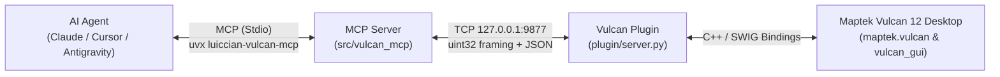

<div align="center">
  <h1>Vulcan MCP</h1>
  <p><b>Model Context Protocol (MCP) server connecting Maptek Vulcan 12 Desktop with AI Agents</b></p>

  <p align="center">
    <a href="https://pypi.org/project/luiccian-vulcan-mcp/"></a>
    <a href="https://github.com/LuiccianDev/vulcan-mcp/blob/master/LICENSE"></a>
    <a href="https://github.com/LuiccianDev/vulcan-mcp/blob/master/pyproject.toml"></a>
    <a href="https://github.com/LuiccianDev/vulcan-mcp/blob/master/docs/MAPTEK_PYTHON_SDK.md"></a>
    <a href="https://modelcontextprotocol.io/"></a>
    <a href="https://docs.astral.sh/uv/"></a>
  </p>

  <p align="center">
    
    
    
    
    
  </p>

  <p align="center">
    <b>
      <a href="#-quick-start-in-2-steps">Quick Start</a> •
      <a href="#-key-capabilities">Capabilities</a> •
      <a href="#-the-9-master-tools-catalog">MCP Tools</a> •
      <a href="#-practical--simple-examples">Practical Examples</a> •
      <a href="https://github.com/LuiccianDev/vulcan-mcp/blob/master/docs/TUTORIAL_FIRST_STEPS.md">Tutorial</a> •
      <a href="https://github.com/LuiccianDev/vulcan-mcp/blob/master/docs/HOW_TO_GUIDES.md">How-To Guides</a> •
      <a href="https://github.com/LuiccianDev/vulcan-mcp/tree/master/docs">Documentation</a> •
      <a href="https://github.com/LuiccianDev/vulcan-mcp/blob/master/CONTRIBUTING.md">Contributing</a>
    </b>
  </p>

</div>

---

Connect **Vulcan 12 ** directly to Artificial Intelligence assistants (**Google Antigravity**, **Claude Desktop**, **Claude Code**, **Cursor**, **VS Code**) via the open **Model Context Protocol (MCP)** standard.

Seamlessly query block models (`.bmf`), audit 3D triangulations and solids (`.00t`), explore ISIS drillhole databases (`.dhd.isis`), interact with CAD design layers (`.dgd.isis`), inspect color legends (`.scd`), capture the Envisage 3D viewport, and execute native PyVulcan automation scripts using natural language.

---

## Key Capabilities

<table width="100%">
  <tr>
    <td width="50%" valign="top">
      <h3>Block Models (<code>.bmf</code>)</h3>
      <ul>
        <li>Volumetric point queries at world coordinates $(X, Y, Z)$.</li>
        <li>Volume-weighted mean grade, volume, and tonnage calculations with cutoffs.</li>
        <li>Schema auditing: extent, dimensions, origin, and estimated variables.</li>
      </ul>
    </td>
    <td width="50%" valign="top">
      <h3>Triangulations & Surfaces (<code>.00t</code> / <code>.tri</code>)</h3>
      <ul>
        <li>Topological consistency, solid closure, and self-intersection validation.</li>
        <li>Total volume, surface area, and 3D centroid calculations.</li>
        <li>$Z$ elevation sampling and point-in-solid verification.</li>
      </ul>
    </td>
  </tr>
  <tr>
    <td width="50%" valign="top">
      <h3>ISIS Exploration Drillholes (<code>.dhd.isis</code>)</h3>
      <ul>
        <li>Bilingual schema support (English & Spanish: <code>COLLARS/COLLARES</code>, <code>ASSAYS/LEYES</code>, <code>DIP/BUZ</code>, <code>FROM/DESDE</code>).</li>
        <li>Automated detection of high-grade mineral intercepts.</li>
        <li>Mathematical desurvey and 3D display colored by grade in Envisage.</li>
      </ul>
    </td>
    <td width="50%" valign="top">
      <h3>CAD Design & 3D Viewport (<code>.dgd.isis</code> / Envisage)</h3>
      <ul>
        <li>Planar area ($m^2$) and centroid calculations for mine benches and polygons.</li>
        <li>Digitize and load temporary or persistent 3D polylines and polygons.</li>
        <li>High-resolution JPEG viewport screenshots for multimodal AI vision.</li>
      </ul>
    </td>
  </tr>
</table>

---

## Communication Architecture

Maptek Vulcan 12 Desktop embeds **Python 3.5.2** tightly linked to its C++/SWIG graphics engine (`maptek.vulcan`). Modern MCP servers require **Python 3.11+**. 

The system bridges both worlds across two processes using a local TCP loopback socket on `127.0.0.1:9877`:



---

## Quick Start (in 2 Steps)

You don't need to manually create or configure virtual environments if you have [`uv` / `uvx`](https://docs.astral.sh/uv/) installed.

> [!IMPORTANT]
> **Strict Execution Order:**
> 1. **STEP 1 (Always First):** Start the listener plugin inside **Maptek Vulcan 12 Desktop**. This opens and binds local TCP port `127.0.0.1:9877`.
> 2. **STEP 2 (Afterwards):** Connect your **AI Client** (Claude Desktop, Cursor, Antigravity, VS Code).
> 
> *⚠️ Connecting your AI assistant before starting the plugin in Vulcan will result in a `ConnectionError`.*

---

### Step 1: Start the Plugin inside Maptek Vulcan 12

1. Open your mining project in **Maptek Vulcan 12 Desktop (Envisage)**.
2. In Vulcan's top menu, go to **File > Python Script** (or type `py` in Vulcan's command window).
3. Select the file [`plugin/server.py`](./plugin/server.py).
4. Check the box **"Run in shell window"** and click **OK**.
5. A Windows console window will open confirming the listener is running:

```text
==============================================================
[Vulcan MCP] Vulcan MCP Listener started on 127.0.0.1:9877
[Vulcan MCP] Working directory: C:\your_mining_project
[Vulcan MCP] Registered domains: block_model, canvas, design, drillholes, execute_code, legend, system, triangulation
[Vulcan MCP] Token authentication: DISABLED (localhost open mode)
[Vulcan MCP] Keep this window open while using your AI client. Ctrl+C to stop.
==============================================================
```

> [!TIP]
> **Keep this console window open** while chatting with your AI assistant. If closed, the TCP socket will terminate.

---

### Step 2: Connect your AI Client

Choose the mode that best fits your workflow:

#### Mode A: For End Users (Zero-Install via `uvx`)
No repository cloning required. The AI client pulls and runs the MCP server on the fly:

* **In Claude Desktop / Cursor / VS Code**:
  Add this block to your MCP config file (`claude_desktop_config.json`, `.cursor/mcp.json`, etc.):
  ```json
  {
    "mcpServers": {
      "vulcan": {
        "command": "uvx",
        "args": [
          "luiccian-vulcan-mcp"
        ]
      }
    }
  }
  ```

* **In Claude Code (CLI)**:
  ```bash
  claude mcp add -s user vulcan -- uvx luiccian-vulcan-mcp
  ```

#### Mode B: For Developers (with `uv run` on a local clone)
If you are developing or modifying the codebase and want hot-reloading:

* **In Google Antigravity**:
  The plugin in [`.agents/plugins/vulcan-mcp/`](./.agents/plugins/vulcan-mcp) is already preconfigured dynamically with `${workspaceFolder}`.

* **Manual Local Configuration**:
  ```json
  {
    "mcpServers": {
      "vulcan": {
        "command": "uv",
        "args": [
          "run",
          "--directory",
          "C:\\path\\to\\vulcan-mcp",
          "vulcan-mcp-server"
        ]
      }
    }
  }
  ```

---

## The 9 Master Tools Catalog

See complete parameter specifications and JSON schemas in [`docs/MCP_TOOLS_REFERENCE.md`](./docs/MCP_TOOLS_REFERENCE.md).

| # | MCP Tool | Mining Domain | Actions (`action=`) | Description |
| :-: | :--- | :--- | :--- | :--- |
| 1 | **`vulcan_system`** | System & Project | `ping`, `project_info`, `capabilities` | Connection health, complete active project file inventory, and available SDK modules. |
| 2 | **`vulcan_block_model`** | Block Models (`.bmf`) | `list`, `info`, `query_xyz`, `stats` | Block model schema, $(X,Y,Z)$ point query, tonnage, volume, and volume-weighted mean grade with cutoffs. |
| 3 | **`vulcan_triangulation`** | Triangulations (`.00t`/`.tri`) | `list`, `info`, `elevation`, `point_inside`, `load`, `unload` | Nodes, faces, volume, topological consistency, centroid, $Z$ elevation, and point-in-solid test. |
| 4 | **`vulcan_design`** | 3D CAD Design (`.dgd.isis`) | `list_dbs`, `list_layers`, `layer_info`, `load_layer`, `clear_temp`, `create_polyline` | CAD layer inspection, planar area ($m^2$), centroid, 3D layer loading, and polyline creation. |
| 5 | **`vulcan_drillholes`** | ISIS Drillholes (`.dhd.isis`) | `list_dbs`, `schema`, `holes`, `hole`, `high_grade`, `display`, `clear_display` | Drillhole database exploration, high-grade intercept search, and desurveyed 3D colored display. |
| 6 | **`vulcan_legend`** | Legends (`.scd`) | `list`, `inspect`, `update`, `restore` | Color scheme inspection and interval color updates with automatic `.scd.bak` backup. |
| 7 | **`vulcan_screenshot`** | Visual 3D Viewport | *(Direct: `max_width`, `quality`)* | Viewport screenshot of Envisage compressed as JPEG for multimodal vision analysis. |
| 8 | **`vulcan_canvas`** | UI & Macros | `macro`, `report` | Envisage Workbench macro execution and writing messages to Vulcan's report window. |
| 9 | **`vulcan_execute_code`** | PyVulcan Scripting | *(Direct: `code`)* | Direct execution of Python scripts inside Maptek Vulcan (`vulcan`, `vulcan_gui`, `project_dir`). |

---

## Practical & Simple Examples

Here are 4 representative mining workflows demonstrating the natural language user prompt, the resulting MCP tool call in JSON, and the returned data.

### 1. Project Health Diagnostic & File Inventory

* **Natural Language Prompt:**
  > *"What mining files and block models are available in the open Vulcan project?"*

* **MCP Tool Call:**
  ```json
  {
    "tool": "vulcan_system",
    "arguments": {
      "action": "project_info"
    }
  }
  ```

* **Returned Response:**
  ```json
  {
    "connected": true,
    "project_dir": "C:\\MiningProjects\\Deposit_Cu_Au",
    "inventory": {
      "block_models": { "count": 2, "files": ["global_deposit.bmf", "phase1.bmf"] },
      "triangulations": { "count": 4, "files": ["topo_2026.00t", "final_pit.00t"] },
      "drillhole_dbs": { "count": 1, "files": ["rc_drilling.dhd.isis"] }
    }
  }
  ```

---

### 2. Mineral Resource Estimation with Cutoff Grade

* **Natural Language Prompt:**
  > *"Calculate the tonnage and mean copper grade (CUT) in 'phase1.bmf' using a cutoff >= 0.40% and density of 2.7 t/m³."*

* **MCP Tool Call:**
  ```json
  {
    "tool": "vulcan_block_model",
    "arguments": {
      "action": "stats",
      "name": "phase1.bmf",
      "variable": "CUT",
      "cutoff": 0.40,
      "default_density": 2.7
    }
  }
  ```

* **Returned Response:**
  ```json
  {
    "total_blocks": 120500,
    "blocks_above_cutoff": 35210,
    "total_volume": 2816800.0,
    "tonnage": 7605360.0,
    "mean_grade": 0.785,
    "variable": "CUT",
    "cutoff": 0.4
  }
  ```

---

### 3. High-Grade Intercept Detection & 3D Display

* **Natural Language Prompt:**
  > *"Find the top 5 gold intercepts in the ASSAYS table of 'rc_drilling.dhd.isis' and display them in Envisage."*

* **MCP Tool Call:**
  ```json
  {
    "tool": "vulcan_drillholes",
    "arguments": {
      "action": "high_grade",
      "name": "rc_drilling.dhd.isis",
      "table": "ASSAYS",
      "field": "AU",
      "top_n": 5
    }
  }
  ```

* **Returned Response:**
  ```json
  {
    "database": "rc_drilling.dhd.isis",
    "table": "ASSAYS",
    "field": "AU",
    "intercepts": [
      { "hole_id": "RC-104", "from": 84.0, "to": 88.0, "grade": 12.45, "length": 4.0 },
      { "hole_id": "RC-112", "from": 120.0, "to": 126.0, "grade": 8.70, "length": 6.0 }
    ]
  }
  ```

> [!WARNING]
> **Graphics Safeguard:** When using the `display` action to render drillhole intervals in Envisage, keep the `limit` parameter moderate ($\le 300$) to prevent freezing the OpenGL graphics thread.

---

### 4. Direct Automation with PyVulcan Scripting

* **Natural Language Prompt:**
  > *"Run a script inside Vulcan that reports the active window title in the report console."*

* **MCP Tool Call:**
  ```json
  {
    "tool": "vulcan_execute_code",
    "arguments": {
      "code": "import maptek.vulcan_gui as vg\nresult = {'window_name': vg.get_window_name() if hasattr(vg, 'get_window_name') else 'Envisage'}"
    }
  }
  ```

* **Returned Response:**
  ```json
  {
    "success": true,
    "result": { "window_name": "Envisage - [C:\\MiningProjects\\Deposit_Cu_Au]" }
  }
  ```

---

## Configuration & Environment Variables

Both the plugin inside Maptek Vulcan and the external MCP server automatically read operating system environment variables (`os.environ`):

| Variable | Default | Type | Description | When is it used? |
| :--- | :--- | :--- | :--- | :--- |
| **`VULCAN_MCP_HOST`** | `127.0.0.1` | String | IP address where the plugin listens and the MCP server connects. | Optional. Change if running Vulcan on a separate VM or container. |
| **`VULCAN_MCP_PORT`** | `9877` | Integer | TCP port for binary `uint32` message transport. | Optional. Change if port 9877 is used by another application. |
| **`VULCAN_MCP_TOKEN`** | `""` (Disabled) | String | Shared secret authenticated via constant-time HMAC. | **Required** if `VULCAN_MCP_HOST` is non-loopback (`!= 127.0.0.1`). Optional on localhost. |

---

## Authentication & Security

### Zero `.env` Philosophy
You do not need to create or manage insecure `.env` files containing plain text passwords that might accidentally be committed to Git. Tokens are managed at the Windows OS environment level:

```powershell
# 1. Generate and save a token permanently in your Windows user account:
$token = python -c "import secrets; print(secrets.token_urlsafe(32))"
[System.Environment]::SetEnvironmentVariable('VULCAN_MCP_TOKEN', $token, 'User')

# 2. Verify that it was stored correctly:
[System.Environment]::GetEnvironmentVariable('VULCAN_MCP_TOKEN', 'User')

# 3. (Optional) To revoke and revert to open mode:
[System.Environment]::SetEnvironmentVariable('VULCAN_MCP_TOKEN', $null, 'User')
```

### Strict Non-Loopback Network Rule
* If you bind `VULCAN_MCP_HOST` to a **non-loopback** interface (e.g., `0.0.0.0` or a LAN IP), the plugin **strictly refuses to start (`RuntimeError`)** unless `VULCAN_MCP_TOKEN` is set, preventing unauthorized remote script execution.

---

## 🛠️ Diagnostics & FAQ

> [!NOTE]
> **Is the assistant hanging on Timeout or not responding?**  
> Maptek Vulcan Desktop is an interactive MFC/C++ application. When an operation triggers a modal dialog popup (e.g. file overwrite confirmation, coordinate system prompt), **Vulcan's main Python thread is completely suspended** until a human clicks OK or Cancel in Vulcan. As soon as the modal is dismissed, processing resumes instantly. See [How to Resolve Modal Dialog Freezes](./docs/HOW_TO_GUIDES.md#6-how-to-diagnose-and-resolve-modal-dialog-freezes-in-vulcan-desktop).

---

## 3-Layer Automated Testing Harness

The project includes automated testing infrastructure organized across 3 validation tiers:

<table width="100%">
  <thead>
    <tr>
      <th align="center">Layer</th>
      <th align="left">Test Level</th>
      <th align="left">Command</th>
      <th align="left">Scope & Target</th>
    </tr>
  </thead>
  <tbody>
    <tr>
      <td align="center"><b>Layer 1</b></td>
      <td>Unit & AST</td>
      <td><code>uv run --no-sync pytest tests/test_vulcan_mcp.py -v</code></td>
      <td>Validates strict Python 3.5.2 compatibility (f-string prohibition in <code>plugin/</code>), domain registration, and token isolation.</td>
    </tr>
    <tr>
      <td align="center"><b>Layer 2</b></td>
      <td>Mock Harness & Agent Eval</td>
      <td><code>uv run --no-sync pytest tests/test_mcp_tools.py tests/test_agent_eval.py -v</code></td>
      <td>Emulates Vulcan's socket listener in-memory using <code>MockVulcanServer</code>. Tests all 9 FastMCP tools and multi-step geologist workflows without opening Vulcan.</td>
    </tr>
    <tr>
      <td align="center"><b>Layer 3</b></td>
      <td>Live Integration</td>
      <td><code>uv run --no-sync pytest tests/test_live.py -v</code></td>
      <td>Live end-to-end tests against a running Maptek Vulcan 12 Desktop session with active Envisage.</td>
    </tr>
  </tbody>
</table>
---

## 🔄 CI/CD & Automated Workflows

The repository uses coordinated, path-filtered GitHub Actions to ensure maximum speed, security, and reproducibility on Windows:

| Workflow | Trigger | Runner | Responsibilities |
| :--- | :--- | :--- | :--- |
| **`CI & Code Quality`** (`ci.yml`) | Pull requests & pushes targeting `src/**`, `plugin/**`, `tests/**`, `pyproject.toml`, `uv.lock` | `windows-latest` | • Ruff linter & format enforcement<br>• Mypy strict type checking<br>• AST check ensuring 100% Python 3.5.2 compatibility in `plugin/`<br>• Pytest matrix on Python 3.11 & 3.12 |
| **`Security Analysis`** (`security.yml`) | Weekly schedule & PRs touching core dependencies | `ubuntu-latest` | • GitHub CodeQL semantic security scan<br>• `pip-audit` vulnerability scanning on frozen production dependencies |
| **`Release Pipeline`** (`release.yml`) | Tag creation (`v*`) | `ubuntu-latest` | • Builds sdist and wheel with `uv build`<br>• Generates SHA-256 cryptographic checksums (`checksums.txt`)<br>• Creates official GitHub Release with release notes and binary assets |
| **`Publish to PyPI`** (`publish-pypi.yml`) | Release published (`release: [published]`) or manual dispatch | `ubuntu-latest` | • OIDC Trusted Publishing (keyless, zero static tokens)<br>• PEP 740 Cryptographic Build Provenance Attestation<br>• Direct publish to [PyPI (`luiccian-vulcan-mcp`)](https://pypi.org/p/luiccian-vulcan-mcp) |

---

## 🏷️ Release Cadence, Versioning & Tag Creation

We strictly adhere to [Semantic Versioning (SemVer 2.0.0)](https://semver.org/):
* **MAJOR (`X.0.0`)**: Incompatible API breaks or major protocol overhaul.
* **MINOR (`0.X.0`)**: Backwards-compatible new MCP tools, handlers, or capabilities.
* **PATCH (`0.0.X`)**: Bug fixes, dependency bumps, performance optimizations, and documentation updates.

### 5-Target Synchronized Versioning (`scripts/bump_version.py`)

To prevent version discrepancies between metadata files, use the unified version bumper:

```powershell
# Preview changes without modifying files:
python scripts/bump_version.py patch --dry-run

# Execute version bump (patch, minor, major, or explicit version):
python scripts/bump_version.py patch
python scripts/bump_version.py minor
python scripts/bump_version.py 0.3.1
```

The script automatically synchronizes all 5 points in a single atomic pass:
1. `pyproject.toml` (`[project] version = "..."`)
2. `src/vulcan_mcp/__init__.py` (`__version__ = "..."`)
3. `.agents/plugins/vulcan-mcp/plugin.json` (`"version": "..."`)
4. `uv.lock` (root package version updated)
5. `CHANGELOG.md` (moves `[Unreleased]` into `[X.Y.Z] - YYYY-MM-DD` and creates a fresh empty `[Unreleased]` section).

### How to Cut a Release & Publish to PyPI

```powershell
# 1. Update version and changelog
python scripts/bump_version.py 0.3.1

# 2. Commit the version bump
git add .
git commit -m "chore(release): bump version to 0.3.1"

# 3. Create an annotated Git tag
git tag -a v0.3.1 -m "Release v0.3.1: Windows CI, PyPI packaging & English docs"

# 4. Push branch and tag to GitHub
git push origin master
git push origin v0.3.1
```

> [!NOTE]
> Pushing the tag `v*` immediately triggers `release.yml`. Once the GitHub Release is published, `publish-pypi.yml` automatically builds, attests, and publishes the package to PyPI without manual token handling.

---

## 🤝 Contributing

Contributions, bug reports, and suggestions are warmly welcomed! Please read our [**Contributing Guide (CONTRIBUTING.md)**](./CONTRIBUTING.md) to learn about:
* Setting up the local development environment with `uv`.
* Feature branch workflows (`feat/*`, `fix/*`) to keep `master` stable.
* Strict Python 3.5.2 compatibility in `plugin/` (no f-strings).
* Conventional Commits and submitting Pull Requests with GitHub CLI (`gh`).

