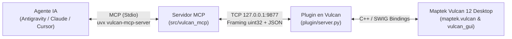

# Vulcan MCP — Connect Maptek Vulcan 12 Desktop to AI Agents via MCP

[](./LICENSE)
[](./pyproject.toml)
[](./docs/MAPTEK_PYTHON_SDK.md)
[](https://docs.astral.sh/uv/)

Conecta **Maptek Vulcan 12 Desktop (Envisage)** directamente con agentes de Inteligencia Artificial (**Google Antigravity**, **Claude Desktop**, **Claude Code**, **Cursor**, **VS Code**) a través del **Model Context Protocol (MCP)**.

Permite consultar modelos de bloques (`.bmf`), auditar triangulaciones 3D (`.00t`), explorar bases de datos de sondajes ISIS (`.dhd.isis`), operar capas CAD (`.dgd.isis`), modificar leyendas (`.scd`), capturar el viewport 3D de Envisage y ejecutar scripts de PyVulcan en lenguaje natural.

---

## 📁 Estructura del Proyecto y Propósito de cada Carpeta

El proyecto está diseñado con una arquitectura modular y desacoplada para garantizar máxima compatibilidad con Maptek Vulcan y los clientes de IA modernos:

```text
vulcan-mcp/
├── plugin/                         # 🟢 Plugin interno para Maptek Vulcan 12 (Python 3.5.2)
│   ├── server.py                   # Servidor socket TCP síncrono ejecutado en el hilo de Vulcan
│   ├── wire.py                     # Serializador JSON para tipos SWIG/C++ y protocolo uint32
│   └── handlers/                   # Controladores por dominio minero (bloques, triangulaciones, etc.)
│       ├── block_models.py         # Consultas y estadísticas de modelos de bloques (.bmf)
│       ├── triangulations.py       # Propiedades geométricas y topológicas (.00t / .tri)
│       ├── design.py               # Operaciones CAD 3D, centroides y áreas planares (.dgd.isis)
│       ├── drillholes.py           # Lectura bilingüe de sondajes ISIS y desurvey 3D (.dhd.isis)
│       ├── legends.py              # Esquemas de color para bloques y sondajes (.scd)
│       ├── canvas.py               # Capturas del viewport y macros de Envisage
│       ├── code.py                 # Ejecución segura de código Python (PyVulcan)
│       ├── system.py               # Diagnósticos de conexión e inventario del proyecto
│       └── common.py               # Tabla de comandos y manejo de errores
│
├── src/vulcan_mcp/                 # 🔵 Servidor MCP externo (Python 3.11+ / FastMCP)
│   ├── server.py                   # Registro de las 9 Master Tools expuestas a los agentes IA
│   ├── client.py                   # Cliente TCP asíncrono hacia el plugin de Vulcan
│   └── protocol.py                 # Protocolo binario de red y lectura de variables de entorno
│
├── docs/                           # 📚 Documentación técnica exhaustiva
│   ├── README.md                   # Índice general de la documentación
│   ├── ARCHITECTURE_AND_SECURITY.md# Protocolo binario TCP uint32, memoria SWIG y seguridad
│   ├── MCP_TOOLS_REFERENCE.md      # Parámetros, esquemas y respuestas JSON de las 9 herramientas
│   ├── VULCAN_FILE_FORMATS.md      # Especificación de formatos (.bmf, .00t, .dhd.isis, .dgd.isis, .scd)
│   └── MAPTEK_PYTHON_SDK.md        # Catálogo de funciones de maptek.vulcan y maptek.vulcan_gui
│
├── .agents/plugins/vulcan-mcp/     # 🤖 Plugin oficial empaquetado para Google Antigravity
│   ├── plugin.json                 # Manifiesto y metadatos del plugin
│   ├── mcp_config.json             # Registro del servidor MCP dentro del agente
│   ├── hooks.json                  # Hook de diagnóstico automático para verificar socket 9877
│   ├── rules/AGENTS.md             # Reglas operativas para asistentes de geología y minería
│   ├── agents/mining-geologist.md  # Definición del agente especialista 'mining-geologist'
│   └── skills/                     # 4 habilidades especializadas con flujos de trabajo guiados
│       ├── vulcan-tools-catalog/   # Catálogo rápido de uso de las herramientas
│       ├── vulcan-file-formats/    # Guía de archivos mineros y herramientas asociadas
│       ├── vulcan-python-sdk/      # Recetas prácticas de scripting PyVulcan
│       └── vulcan-workflow/        # Flujos de auditoría, modelamiento y visualización 3D
│
├── tests/                          # 🧪 Suite de pruebas automatizadas
│   ├── test_vulcan_mcp.py          # 9 pruebas unitarias rápidas (sin requerir Vulcan abierto)
│   └── test_live.py                # 9 niveles de integración en vivo contra Vulcan Desktop
│
├── LICENSE                         # Licencia Apache License 2.0 (Apache-2.0)
├── NOTICE                          # Aviso legal de autoría original y marcas de Maptek Pty Ltd
└── pyproject.toml                  # Configuración de empaquetado y dependencias para uv/uvx
```

---

## 🏗 Arquitectura de Comunicación

Maptek Vulcan 12 Desktop cuenta con su propio intérprete embebido de **Python 3.5.2** compilado junto a las librerías nativas C++/SWIG (`maptek.vulcan`). El servidor MCP moderno requiere **Python 3.11+**. 

Por ello, el proyecto se divide en dos procesos comunicados mediante un socket TCP local en `127.0.0.1:9877`:



---

## 🚀 Inicio Rápido (Quick Start en 2 Pasos)

No necesitas crear ni configurar entornos virtuales manualmente si utilizas [`uv` / `uvx`](https://docs.astral.sh/uv/).

> [!IMPORTANT]
> **Regla de Oro: El Orden de Ejecución es Estricto**
> 1. **PASO 1 (Siempre Primero)**: Se levanta el servidor/plugin dentro de **Maptek Vulcan 12 Desktop**. Esto inicializa el puerto TCP local en `127.0.0.1:9877` y lo deja escuchando.
> 2. **PASO 2 (Después)**: Se abre o conecta el **Cliente de IA** (Claude Desktop, Cursor, Antigravity, VS Code).
> 
> *⚠️ Si intentas conectar tu asistente de IA antes de haber levantado el plugin en Vulcan, el cliente fallará con el mensaje:*
> `ConnectionError: Cannot connect to Maptek Vulcan on 127.0.0.1:9877. Ensure Vulcan Desktop is open and plugin/server.py is running.`

---

### Paso 1: Iniciar el Servidor/Plugin dentro de Maptek Vulcan 12

1. Abre tu proyecto minero en **Maptek Vulcan 12 Desktop (Envisage)**.
2. En el menú superior de Vulcan, ve a **File > Python Script** (o teclea `py` en la ventana de comandos).
3. Selecciona el archivo [`plugin/server.py`](./plugin/server.py).
4. Marca la casilla **"Run in shell window"** y haz clic en **OK**.
5. Se abrirá la consola de comandos de Windows confirmando el servicio:
   ```text
   ==============================================================
   [Vulcan MCP] Vulcan MCP Listener started on 127.0.0.1:9877
   [Vulcan MCP] Working directory: C:\tu_proyecto_minero
   [Vulcan MCP] Registered domains: block_model, canvas, design, drillholes, execute_code, legend, system, triangulation
   [Vulcan MCP] Token authentication: DISABLED (localhost open mode)
   [Vulcan MCP] Keep this window open while using your AI client. Ctrl+C to stop.
   ==============================================================
   ```

> [!TIP]
> **No cierres esta ventana de consola** mientras interactúes con tu asistente de IA. Si la cierras, el socket TCP se detendrá.

---

### Paso 2: Conectar tu Cliente de IA

Elige la modalidad que mejor se adapte a tu necesidad:

#### Modalidad A: Para Usuarios Finales (con `uvx` directo desde GitHub)
No requiere clonar el repositorio en otras máquinas. El cliente de IA descarga y ejecuta el servidor MCP al vuelo:

* **En Claude Desktop / Cursor / VS Code / Windsurf**:
  Añade este bloque en tu archivo `mcpServers` (`claude_desktop_config.json`, `.cursor/mcp.json`, etc.):
  ```json
  {
    "mcpServers": {
      "vulcan": {
        "command": "uvx",
        "args": [
          "--from",
          "https://github.com/LuiccianDev/vulcan-mcp/archive/refs/heads/master.zip",
          "vulcan-mcp-server"
        ]
      }
    }
  }
  ```

* **En Claude Code (CLI)**:
  ```bash
  claude mcp add -s user vulcan -- uvx --from https://github.com/LuiccianDev/vulcan-mcp/archive/refs/heads/master.zip vulcan-mcp-server
  ```

#### Modalidad B: Para Desarrolladores (con `uv run` en tu copia local)
Si estás editando el código en tu equipo y deseas que cualquier cambio se refleje al instante (*hot-reload*):

* **En Google Antigravity**:
  El plugin en [`.agents/plugins/vulcan-mcp/`](./.agents/plugins/vulcan-mcp) ya viene preconfigurado dinámicamente con `${workspaceFolder}`.

* **Configuración Manual Local**:
  ```json
  {
    "mcpServers": {
      "vulcan": {
        "command": "uv",
        "args": [
          "run",
          "--directory",
          "C:\\path\\to\\vulcan-mcp",
          "vulcan-mcp-server"
        ]
      }
    }
  }
  ```
  *(Reemplaza `C:\\path\\to\\vulcan-mcp` o `/path/to/vulcan-mcp` por la ruta absoluta de tu repositorio clonado).*

---

## 🧰 Catálogo de las 9 Herramientas Maestras

Consulta todos los parámetros y respuestas JSON en [`docs/MCP_TOOLS_REFERENCE.md`](./docs/MCP_TOOLS_REFERENCE.md).

| # | Herramienta MCP | Dominio Minero | Acciones (`action=`) | Descripción |
| :-: | :--- | :--- | :--- | :--- |
| 1 | **`vulcan_system`** | Sistema y Proyecto | `ping`, `project_info`, `capabilities` | Estado de la conexión, inventario completo de archivos del proyecto y módulos SDK disponibles. |
| 2 | **`vulcan_block_model`** | Modelos de Bloques (`.bmf`) | `list`, `info`, `query_xyz`, `stats` | Esquema de bloques, consulta en $(X,Y,Z)$, tonelaje, volumen y ley media ponderada por corte (`cutoff`). |
| 3 | **`vulcan_triangulation`** | Triangulaciones (`.00t`/`.tri`) | `list`, `info`, `elevation`, `point_inside`, `load`, `unload` | Nodos, caras, volumen, consistencia topológica, centroide, cota $Z$ y punto dentro de sólido. |
| 4 | **`vulcan_design`** | Diseño CAD 3D (`.dgd.isis`) | `list_dbs`, `list_layers`, `layer_info`, `load_layer`, `clear_temp`, `create_polyline` | Inspección de capas CAD, longitud, área planar ($m^2$), centroide, carga en 3D y creación de polilíneas. |
| 5 | **`vulcan_drillholes`** | Sondajes ISIS (`.dhd.isis`) | `list_dbs`, `schema`, `holes`, `hole`, `high_grade`, `display`, `clear_display` | Tablas y columnas de sondajes, búsqueda de alta ley y *desurvey* 3D coloreado por ley en Envisage. |
| 6 | **`vulcan_legend`** | Leyendas (`.scd`) | `list`, `inspect`, `update`, `restore` | Inspección y actualización de esquemas de color con copia de seguridad `.scd.bak`. |
| 7 | **`vulcan_screenshot`** | Captura Visual 3D | *(Directa: `max_width`, `quality`)* | Captura de pantalla de la ventana 3D de Envisage comprimida en JPEG. |
| 8 | **`vulcan_canvas`** | Interfaz y Macros | `macro`, `report` | Ejecución de macros de Envisage Workbench y escritura en la ventana de reportes. |
| 9 | **`vulcan_execute_code`** | Scripting PyVulcan | *(Directa: `code`)* | Ejecución directa de Python dentro de Maptek Vulcan (`vulcan`, `vulcan_gui`, `project_dir`). |

---

## 💡 Ejemplos de Consultas en Lenguaje Natural

Una vez conectado tu agente, puedes pedirle análisis geológicos y mineros directos:

* **Auditoría de Proyecto**: *"Haz un inventario completo de las triangulaciones, modelos de bloques y bases de datos ISIS en el proyecto abierto."*
* **Cálculo de Recursos / Tonelaje**: *"Calcula el tonelaje y ley media de cobre (`CUT`) en el modelo `bmw_ml_30_30_30.bmf` aplicando una ley de corte de 0.5% y densidad de 2.7 t/m³."*
* **Control Topográfico**: *"Verifica si la superficie `topografia_1.00t` es topológicamente consistente y cuál es la cota Z en las coordenadas (474665, 4479896)."*
* **Exploración de Sondajes**: *"Identifica los 5 interceptos con mayor ley de cobre en la tabla `LEYES` de `bmw_sondajes.dhd.isis`, dibújalos en 3D y toma una captura de pantalla de Envisage."*
* **Área de Polígonos de Diseño**: *"Muestra las capas de la base `diseño_mina.dgd.isis` y calcula el área planar en m² y centroide de la capa `BANCO_100`."*

---

## ⚙️ Configuración y Variables de Entorno (Configuration)

Tanto el plugin dentro de Maptek Vulcan como el servidor MCP leen automáticamente las variables de entorno del sistema (`os.environ`). Si defines las variables en Windows una sola vez, **ambos extremos las reconocen automáticamente** sin necesidad de repetir configuraciones en archivos JSON.

### Tabla de Variables Disponibles

| Variable | Por Defecto | Tipo | Descripción | ¿Cuándo se utiliza? |
| :--- | :--- | :--- | :--- | :--- |
| **`VULCAN_MCP_HOST`** | `127.0.0.1` | String | Dirección IP donde el plugin abre el socket TCP y el cliente MCP se conecta. | Opcional. Cámbiala si ejecutas Vulcan en una máquina o contenedor diferente. |
| **`VULCAN_MCP_PORT`** | `9877` | Entero | Puerto TCP para la transmisión de mensajes binarios `uint32`. | Opcional. Cámbiala si el puerto 9877 está en uso por otra aplicación. |
| **`VULCAN_MCP_TOKEN`** | `""` (Desactivado) | String | Secreto compartido autenticado mediante HMAC en tiempo constante. | **Obligatorio** si `VULCAN_MCP_HOST` no es loopback (`!= 127.0.0.1`). Opcional en localhost. |

---

## 🔐 Autenticación y Seguridad (Authentication & Security)

### ¿Por qué el Token es Opcional pero Altamente Recomendado?

> [!TIP]
> **El Token como Pared de Seguridad (Security Wall)**:
> * **Para empezar rápido en local**: No necesitas configurar ningún token. El socket escucha en `127.0.0.1` en modo abierto y puedes interactuar al instante (*plug-and-play*).
> * **Como Pared de Protección**: Dado que la herramienta `vulcan_execute_code` permite ejecutar código Python dentro de Maptek Vulcan, configurar `VULCAN_MCP_TOKEN` levanta una pared de seguridad local. Esto garantiza que **únicamente tu asistente de IA autorizado** pueda ejecutar acciones en tu sesión abierta de Vulcan, previniendo que cualquier otro script o proceso local aleatorio envíe instrucciones al socket.

---

### ¿Cómo configurar el Token de Seguridad? (Sin archivos `.env`)

El proyecto adopta una **filosofía Cero `.env`**: no necesitas crear ni mantener archivos de texto con contraseñas que puedan commitearse por error a GitHub. El token se gestiona a nivel de sistema operativo en Windows.

#### Método 1: Permanente en Windows vía PowerShell (Recomendado)
Abre PowerShell y ejecuta:
```powershell
# 1. Generar y guardar el token permanentemente en tu usuario de Windows:
$token = python -c "import secrets; print(secrets.token_urlsafe(32))"
[System.Environment]::SetEnvironmentVariable('VULCAN_MCP_TOKEN', $token, 'User')

# 2. Verificar que quedó guardado correctamente:
[System.Environment]::GetEnvironmentVariable('VULCAN_MCP_TOKEN', 'User')

# 3. (Opcional) Si en el futuro deseas borrarlo y volver al modo abierto:
[System.Environment]::SetEnvironmentVariable('VULCAN_MCP_TOKEN', $null, 'User')
```
> [!NOTE]
> Al guardarlo con el alcance `'User'`, queda registrado en tu perfil de Windows. Esto permite que:
> * **Maptek Vulcan** lea el token automáticamente al iniciar `plugin/server.py`.
> * **Tu cliente MCP con `uvx`** descargado desde GitHub herede el token automáticamente sin tener que escribirlo en ningún archivo JSON.

#### Método 2: Mediante la Interfaz Gráfica de Windows (GUI)
1. Presiona `Win + R`, escribe `sysdm.cpl` y pulsa **Enter**.
2. Ve a la pestaña **Opciones avanzadas** y haz clic en **Variables de entorno...**.
3. En la sección superior (**Variables de usuario**), pulsa **Nueva...**.
4. Ingresa:
   * **Nombre de variable**: `VULCAN_MCP_TOKEN`
   * **Valor de variable**: Tu clave secreta (ej. `mi-clave-secreta-2026`).
5. Acepta y cierra los cuadros de diálogo.

#### Método 3: Inyección Local en el JSON del Cliente (Bloque `"env"`)
Si prefieres no tocar las variables de Windows y pasar el token exclusivamente a un cliente MCP específico:
```json
{
  "mcpServers": {
    "vulcan": {
      "command": "uvx",
      "args": [
        "--from",
        "https://github.com/LuiccianDev/vulcan-mcp/archive/refs/heads/master.zip",
        "vulcan-mcp-server"
      ],
      "env": {
        "VULCAN_MCP_TOKEN": "mi-clave-secreta-2026"
      }
    }
  }
}
```

---

### Regla Estricta de Red Non-Loopback
Siguiendo las mejores prácticas de seguridad de [`nkarasiak/qgis-mcp`](https://github.com/nkarasiak/qgis-mcp):
* Si configuras `VULCAN_MCP_HOST` en una dirección que **no sea loopback** (por ejemplo `0.0.0.0` o `192.168.x.x`), el plugin **se niega a iniciar (`RuntimeError`)** a menos que `VULCAN_MCP_TOKEN` esté definido, impidiendo exponer ejecución remota de código en la red sin contraseña.

---

## 🧪 Pruebas Automatizadas

* **Pruebas Unitarias (sin requerir Vulcan abierto)**:
  ```powershell
  uv run --no-sync pytest tests/test_vulcan_mcp.py -v
  ```
* **Pruebas de Integración en Vivo (con Maptek Vulcan 12 y el plugin activos)**:
  ```powershell
  uv run --no-sync pytest tests/test_live.py -v
  ```

---

## ⚖️ Autoría, Licencia y Aviso Legal

* **Autor Original**: **DAVID (`LuiccianDev`)** — Copyright © 2026.
* **Licencia**: Distribuido bajo la licencia **[Apache License, Version 2.0 (Apache-2.0)](./LICENSE)**.
  * **Atribución obligatoria (`Sección 4.d`)**: Cualquier redistribución o derivado debe conservar íntegramente los avisos de autoría contenidos en [`NOTICE`](./NOTICE).
  * **Registro de cambios (`Sección 4.b`)**: Cualquier archivo modificado por terceros debe incluir un aviso claro indicando que fue alterado.
* **Aviso de Marcas Registradas**: *Maptek®, Vulcan®, Envisage® y Workbench® son marcas registradas de Maptek Pty Ltd. Este proyecto es un desarrollo independiente y no incluye ni redistribuye binarios ni código propietario de Maptek.*
