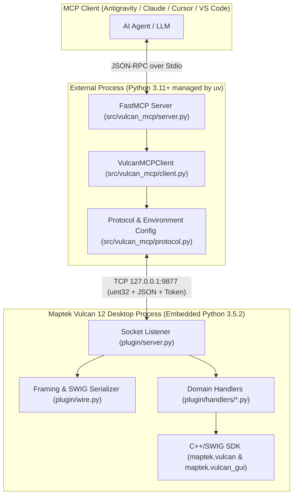

# Internal Architecture, TCP Protocol & Security (Vulcan MCP)

This document describes the internal engineering design of **Vulcan MCP**, the binary framing transport protocol between the MCP server and Maptek Vulcan 12 Desktop, SWIG/OpenGL memory management, and the token-based security architecture.

---

## 1. Why a Two-Process Architecture?

Maptek Vulcan 12 Desktop embeds an internal Python runtime based on **Python 3.5.2**, compiled alongside native C++/SWIG bindings (`maptek.vulcan` and `maptek.vulcan_gui`). Conversely, the official **Model Context Protocol SDK (`mcp` / `FastMCP`)** and `Pydantic v2` require **Python 3.11+**.

To resolve this incompatibility without altering the core Maptek Vulcan installation:



---

## 2. Binary Transport Protocol (`wire.py` & `protocol.py`)

The TCP channel between `src/vulcan_mcp/protocol.py` and `plugin/wire.py` uses **Length-Prefixed JSON Framing**:

1. **Header (4 bytes)**: Unsigned 32-bit integer in big-endian network byte order (`struct.Struct("!I")`) indicating exact payload length in bytes.
2. **Payload ($N$ bytes)**: UTF-8 encoded JSON string (maximum allowed payload: `64 MB`).
3. **SWIG Type Serialization (`wire._default`)**:
   * Calls to `maptek.vulcan` return C++ SWIG wrappers (`double_list`, `string_list`, custom iterators, and C scalars).
   * The custom serializer automatically downcasts these types to native JSON `float`, `list`, or `str` before socket transmission.

### Request Envelope Structure
```json
{
  "type": "block_model",
  "params": {
    "action": "stats",
    "model": "bmw_ml_30_30_30.bmf",
    "variable": "CUT",
    "cutoff": 0.5,
    "density": 2.7
  },
  "token": "vulcan-mcp-2026-secret-key"
}
```

### Response Envelope Structure
* **Success**:
  ```json
  {
    "status": "success",
    "result": { ... }
  }
  ```
* **Controlled Error or Exception**:
  ```json
  {
    "status": "error",
    "message": "Human-readable error description",
    "traceback": "Optional python traceback..."
  }
  ```

---

## 3. Main-Thread Execution Model & SWIG Memory Management

### Synchronous Execution for OpenGL Thread Safety
In `plugin/server.py`, incoming socket requests are processed synchronously on Vulcan's main Python script thread (`handle_client(conn)`). This is essential because `maptek.vulcan_gui` interacts directly with Envisage's OpenGL rendering pipeline, which is **not thread-safe** if called from background worker threads.

### Reference Retention for `vulcan_gui.temp_object`
When a temporary 3D graphic object is created in the Envisage viewport (`tobj = vg.temp_object(polyline)`), the C++ SWIG wrapper destroys the object and removes it from the display the moment Python's garbage collector frees the `tobj` variable.
* To keep visual objects rendered in 3D, `drillholes.py` and `design.py` retain `(tobj, polyline)` tuples in module-level global lists (`_ACTIVE_TEMP_OBJECTS` and `_DESIGN_TEMP_OBJECTS`) until the user or agent explicitly calls `clear_display` or `clear_temp`.

---

## 4. Security & Token Authentication (`VULCAN_MCP_TOKEN`)

Adopting the desktop MCP security model pioneered by tools such as [`nkarasiak/qgis-mcp`](https://github.com/nkarasiak/qgis-mcp):

### 1. Default Behavior (Loopback `127.0.0.1`)
* By default, the listener binds exclusively to `127.0.0.1` (`localhost`) on port `9877` with token authentication **disabled** to provide frictionless zero-config operation with `uvx` or `uv run`.

### 2. Optional Token Activation (`VULCAN_MCP_TOKEN`)
* Because the listener exposes `vulcan_execute_code` (arbitrary Python execution in Maptek Vulcan's process), activating a token creates a local security perimeter.
* Under our zero `.env` philosophy, tokens are saved directly into the Windows user environment via PowerShell:
  ```powershell
  # 1. Generate and save permanently in Windows User environment:
  $token = python -c "import secrets; print(secrets.token_urlsafe(32))"
  [System.Environment]::SetEnvironmentVariable('VULCAN_MCP_TOKEN', $token, 'User')

  # 2. Verify:
  [System.Environment]::GetEnvironmentVariable('VULCAN_MCP_TOKEN', 'User')

  # 3. Revoke/Delete to revert to open mode:
  [System.Environment]::SetEnvironmentVariable('VULCAN_MCP_TOKEN', $null, 'User')
  ```
* Because it is stored in the OS environment, both Maptek Vulcan and the external `uvx` process read it automatically via `os.environ`. Alternatively, MCP clients can inject it into their configuration JSON `"env"` block.

### 3. Strict Non-Loopback Binding Rule (`validate_binding_security`)
* If you set `VULCAN_MCP_HOST` to any **non-loopback** IP address (anything other than `127.0.0.1`, `localhost`, or `::1`, such as `0.0.0.0` or a local LAN IP), **`VULCAN_MCP_TOKEN` becomes mandatory**.
* The listener calls `validate_binding_security()` during startup and **strictly refuses to start (`RuntimeError`)** if `VULCAN_MCP_TOKEN` is empty, preventing accidental unauthenticated remote execution exposure.

### 4. Constant-Time Cryptographic Verification
In [`plugin/server.py`](../plugin/server.py):
```python
def _check_auth(req):
    expected = _get_expected_token()
    if not expected:
        return True
    provided = str(req.get("token") or "")
    return hmac.compare_digest(provided.encode("utf-8"), expected.encode("utf-8"))
```
* Uses `hmac.compare_digest` to prevent side-channel timing attacks.

---

## 5. Hot-Reloading Handlers without Restarting Vulcan

When modifying any handler file in `plugin/handlers/`, you do not need to close or restart the script inside Maptek Vulcan. You can dynamically reload modules in memory by calling `vulcan_execute_code`:

```python
import importlib
import handlers.triangulations
import handlers.design
import handlers.drillholes

importlib.reload(handlers.triangulations)
importlib.reload(handlers.design)
importlib.reload(handlers.drillholes)
result = "Handlers reloaded successfully"
```
