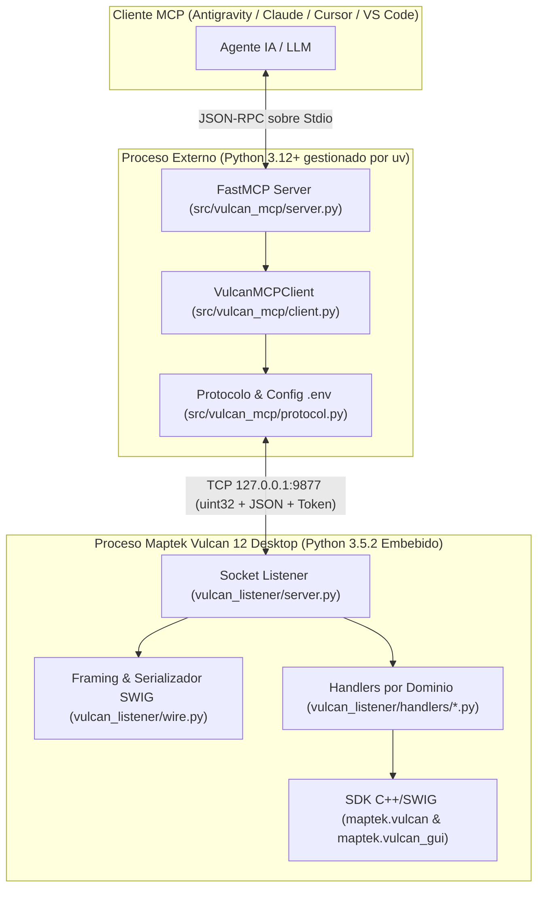

# Arquitectura Interna, Protocolo TCP y Seguridad (Vulcan MCP)

Este documento describe el diseño interno de **Vulcan MCP**, el protocolo de transporte binario entre el servidor MCP y Maptek Vulcan 12 Desktop, la gestión de memoria gráfica SWIG/OpenGL y el modelo de autenticación por token.

---

## 1. ¿Por qué una Arquitectura en Dos Procesos?

Maptek Vulcan 12 Desktop incorpora un intérprete interno basado en **Python 3.5.2** compilado junto a las librerías nativas C++/SWIG (`maptek.vulcan` y `maptek.vulcan_gui`). Por otro lado, el SDK oficial del **Model Context Protocol (`mcp` / `FastMCP`)** y `Pydantic v2` requieren **Python 3.11+**.

Para resolver esta incompatibilidad sin modificar la instalación de Maptek Vulcan:



---

## 2. Protocolo de Transporte Binario (`wire.py` & `protocol.py`)

El canal TCP entre `src/vulcan_mcp/protocol.py` y `vulcan_listener/wire.py` utiliza **Length-Prefixed JSON Framing**:

1. **Cabecera (4 bytes)**: Entero sin signo de 32 bits en orden de red *big-endian* (`struct.Struct("!I")`) que indica la longitud exacta en bytes del payload.
2. **Payload ($N$ bytes)**: Documento JSON codificado en UTF-8 (tamaño máximo permitido: `64 MB`).
3. **Serialización de Tipos SWIG (`wire._default`)**:
   * Las llamadas a `maptek.vulcan` devuelven contenedores C++ envueltos por SWIG (`double_list`, `string_list`, iteradores y escalares C).
   * El serializador convierte automáticamente estos objetos a `float`, `list` o `str` nativos de JSON antes de transmitirlos por el socket.

### Estructura del Sobre de Petición (Request Envelope)
```json
{
  "type": "block_model",
  "params": {
    "action": "stats",
    "model": "bmw_ml_30_30_30.bmf",
    "variable": "CUT",
    "cutoff": 0.5,
    "density": 2.7
  },
  "token": "vulcan-mcp-2026-secret-key"
}
```

### Estructura del Sobre de Respuesta (Response Envelope)
* **Éxito**:
  ```json
  {
    "status": "success",
    "result": { ... }
  }
  ```
* **Error controlado o excepción**:
  ```json
  {
    "status": "error",
    "message": "Descripción legible del error",
    "traceback": "Traceback opcional..."
  }
  ```

---

## 3. Modelo de Ejecución en el Hilo Principal y Memoria SWIG

### Ejecución Síncrona para Seguridad OpenGL
En `vulcan_listener/server.py`, las conexiones entrantes se procesan de forma síncrona en el hilo principal del script de Vulcan (`handle_client(conn)`). Esto es indispensable porque `maptek.vulcan_gui` interactúa directamente con el contexto gráfico OpenGL de Envisage, el cual no es *thread-safe* si se invoca desde hilos secundarios.

### Retención de Referencias para `vulcan_gui.temp_object`
Cuando se crea un objeto gráfico temporal en la ventana 3D de Envisage (`tobj = vg.temp_object(polyline)`), el wrapper SWIG en C++ destruye y borra el dibujo de la pantalla en el instante en que el recolector de basura de Python elimina la variable `tobj`.
* Para mantener los objetos visibles en 3D, los módulos `drillholes.py` y `design.py` conservan las tuplas `(tobj, polyline)` en las listas globales `_ACTIVE_TEMP_OBJECTS` y `_DESIGN_TEMP_OBJECTS` hasta que el usuario o el agente invoca `clear_display` o `clear_temp`.

---

## 4. Seguridad y Autenticación por Token (`VULCAN_MCP_TOKEN`)

### Resolución Jerárquica de Configuración
Tanto `src/vulcan_mcp/protocol.py` como `vulcan_listener/server.py` resuelven `VULCAN_MCP_HOST`, `VULCAN_MCP_PORT` y `VULCAN_MCP_TOKEN` con la siguiente prioridad:
1. **Variable de Entorno del Sistema (`os.getenv`)**: Si está definida en el entorno del proceso.
2. **Archivo `.env` en la raíz del repositorio (`vulcan-mcp/.env`)**: Leído dinámicamente en cada petición si la variable de entorno no está presente.

### Validación Criptográfica en Tiempo Constante
En `vulcan_listener/server.py`:
```python
def _check_auth(req):
    expected = TOKEN or _get_config("VULCAN_MCP_TOKEN", "")
    if not expected:
        return True
    provided = str(req.get("token") or "")
    return hmac.compare_digest(provided.encode("utf-8"), expected.encode("utf-8"))
```
* Se utiliza `hmac.compare_digest` para evitar ataques de temporización (*timing attacks*).
* Si el token no coincide o no se envía cuando `.env` define `VULCAN_MCP_TOKEN`, el listener rechaza la petición antes de tocar cualquier handler del SDK.

---

## 5. Recarga en Caliente (Hot-Reload) sin Reiniciar Vulcan

Cuando se edita cualquier handler dentro de `vulcan_listener/handlers/`, no es necesario cerrar ni reiniciar el script dentro de Maptek Vulcan. Puedes recargar el módulo en memoria enviando a `vulcan_execute_code`:

```python
import importlib
import handlers.triangulations
import handlers.design
import handlers.drillholes

importlib.reload(handlers.triangulations)
importlib.reload(handlers.design)
importlib.reload(handlers.drillholes)
result = "Handlers recargados exitosamente"
```
